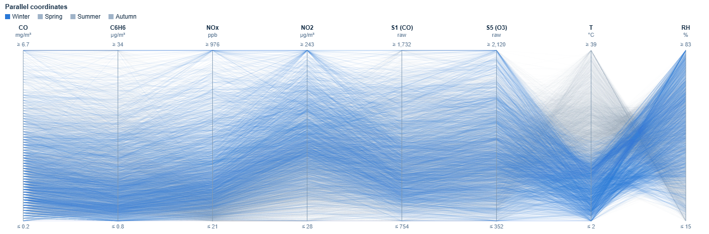
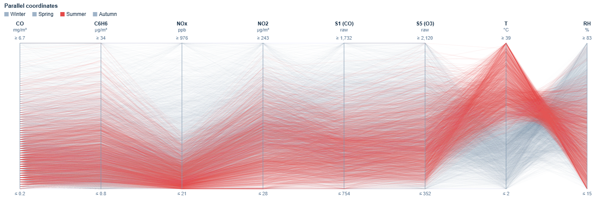
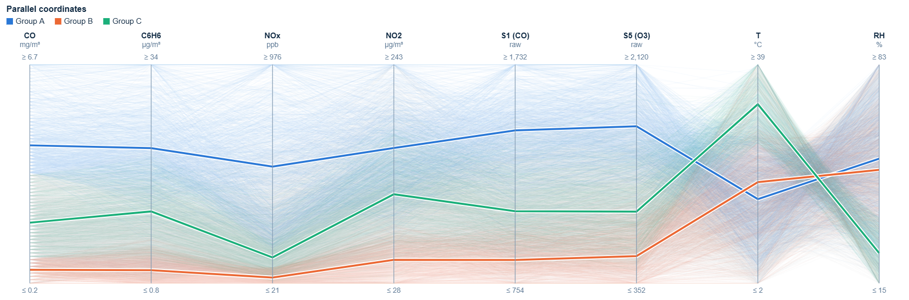
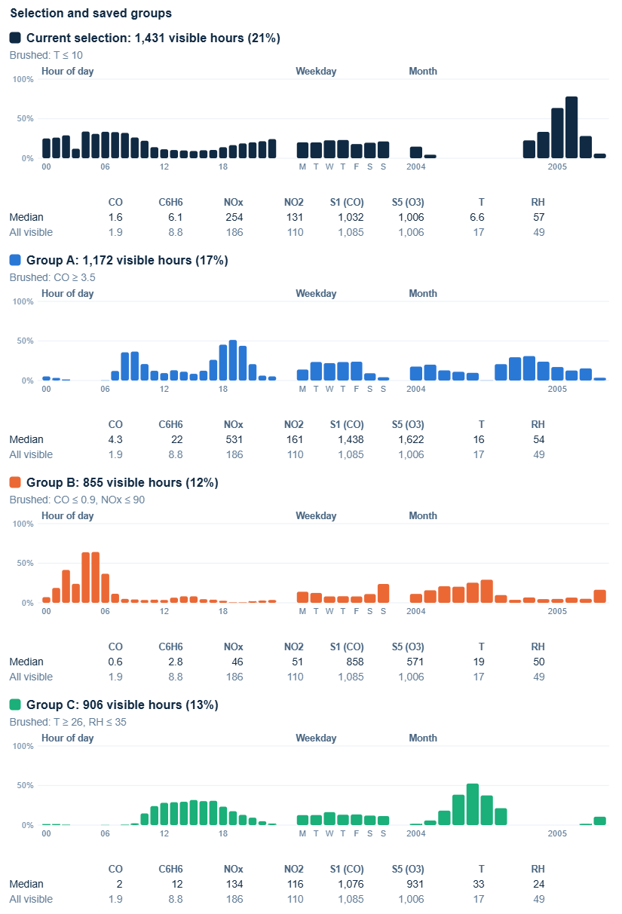
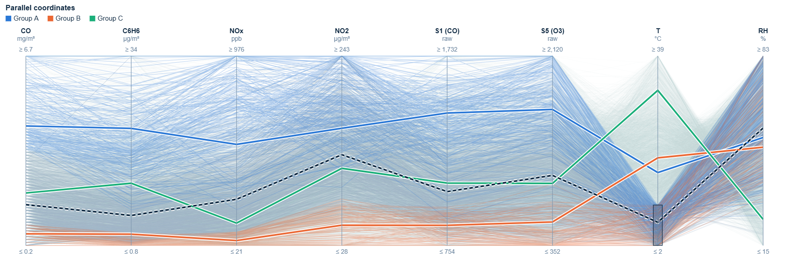

# Air Quality Sensor Data Analysis

COMP5048 Assignment 2, Group 5048-CC-03-G06

Kavvin Udhayakumar Valarmathi, Yan, Caroline, Xueqi Bao

## 1. Introduction

In this report we analyse the UCI Air Quality dataset, which contains hourly readings from a chemical multisensor device placed at road level in an Italian city, together with reference analyser values and weather measurements. We built our own interactive visual analytics tool and used it to find groups of hours with similar pollution profiles (Task 1), to follow how these groups change over time (Task 2), and to look for a critical moment and test what-if changes (Task 3). Task 4 evaluates the tool.

## 2. Data and preprocessing

### 2.1 Dataset

The dataset has 9,357 hourly records from 10 March 2004 18:00 to 4 April 2005 14:00. The hours are continuous, with no duplicate or missing timestamps. Besides Date and Time there are 13 value columns:

- five reference analyser concentrations: CO(GT), NMHC(GT), C6H6(GT), NOx(GT), NO2(GT)
- five metal-oxide sensor responses: PT08.S1 to PT08.S5
- temperature (T), relative humidity (RH) and absolute humidity (AH)

Missing values are coded as −200.

### 2.2 Data quality checks

Before cleaning, we checked the raw files ourselves instead of relying only on the documentation. The main issues were:

| Issue | What we found | How we handled it |
|---|---|---|
| File format | The CSV uses `;` as separator and a decimal comma, and has 2 empty trailing columns and 114 blank rows at the end | Read with the right separator and decimal; dropped the empty rows and columns |
| Missing values | −200 is the only missing code. CO(GT) is 18.0% missing, NOx(GT) 17.5%, NO2(GT) 17.5%, NMHC(GT) 90.2%, all other columns 3.9% | Replaced −200 with NaN. **No imputation of any kind** |
| Missingness is not random | All sensor, T, RH and AH columns go missing together (366 hours of device outage); 31 hours have no data at all; NOx and NO2 are missing at 03:00 on 93% of days and CO at 04:00 on 54% of days | Kept the gaps visible in our views and treated 03:00 and 04:00 with care |
| NMHC(GT) | Only valid until 1 May 2004 | Not used |
| C6H6(GT) vs PT08.S2(NMHC) | C6H6 is almost a perfect function of the S2 sensor (Spearman 0.99998): the same S2 value always gives the same C6H6 value (within 0.1), and both are missing in exactly the same hours | Treated as one signal (see 2.4) |
| AH | AH matches the water vapour pressure (in kPa) calculated from T and RH, so it is derived from those two columns | Not used, because T and RH already carry this information |
| Units | NOx(GT) is in ppb but NO2(GT) is in µg/m³ | Never plotted on a shared axis |
| Sensor drift | At a fixed NOx level the PT08.S3 response ranges from 620 to 923 depending on the month, and PT08.S4 follows T and AH (r = 0.56 and 0.63) more than NO2 (r = 0.16) | Avoided S3 and S4; noted drift as a limitation |

### 2.3 Cleaning

The cleaning script (`preprocessing/clean.py`) reads the raw CSV, drops the blank rows and columns, and combines Date and Time into one timestamp. It then checks that the timestamps are unique, in order and have no missing hours, and replaces −200 with NaN.

At the end it validates the result:
- no rows were lost
- no −200 is left
- the number of NaNs in each column equals the number of −200 values in the raw file
- every other value is unchanged

The last two checks show that nothing was filled in or changed. The output is `data/processed/air_quality_clean.csv`.

### 2.4 Attribute selection

The brief asks for at least eight attributes including a time attribute, used the same way in every task. We chose:

**Timestamp, CO(GT), C6H6(GT), NOx(GT), NO2(GT), PT08.S1(CO), PT08.S5(O3), T, RH** (9 attributes)

- **Coverage of attribute types.** We wanted the true pollutant concentrations (the four analyser values), some sensor responses (S1 and S5) and the environment (T and RH).
- **Exclusions:**
  - NMHC(GT): mostly missing.
  - AH: derived from T and RH.
  - PT08.S2: duplicates C6H6.
  - PT08.S3 and PT08.S4: they showed the strongest drift and temperature effects, so groups found with them could come from the instrument rather than the air.
- **Missing data.** Views that show all attributes at once can only use hours where every attribute is valid. With our set that is 6,941 hours (74%). The lowest month is October 2004, with 50%, because of a long analyser gap.

**Overlaps.** Some of our attributes overlap. C6H6 and CO are strongly related (r = 0.93), and S1 and S5 both follow CO (r = 0.88 and 0.85) and each other (r = 0.90). A group defined by "high CO, C6H6, S1 and S5" therefore shows one traffic signal seen four times, not four independent factors. We kept this in mind when describing the groups.

## 3. Visual analytic tool

We built a web application (`code/task-1/html/index.html`) with four linked views. All views use the same 6,941 complete hours, and hour of day, weekday, month and season are derived from the timestamp.

| View | Encoding | Purpose |
|---|---|---|
| Parallel coordinates (main view) | One line per hour across the eight attributes. Colour can be season, time of day (four 6-hour bands), weekday/weekend or saved group | Hours with similar profiles form bundles of lines, and the axes the bundle passes through show which attributes define it |
| Scatterplot | Any two attributes, same colours | Checks separation and density for a pair of attributes |
| Daily heatmap | One row per day, one column per attribute; daily median shown by colour (light to dark blue) and cell width; a bar shows how many selected hours each day has | Shows groups of days, such as weekly patterns and pollution episodes |
| Group panel | For each hour of day, weekday and month, the share of hours in that slot that belong to the group, plus a table of medians | Shows which time periods make up a group |

**Design choices**
- **Axis order:** analysers first, then sensors, then T and RH, so related pollutants sit next to each other and bundles look like parallel lines. Users can drag axes to reorder them.
- **Axis scale:** each axis runs from the 1st to the 99th percentile, with the raw end values written on the axis. With the full minimum to maximum, a few extreme hours squeezed most lines into the bottom of the CO and NOx axes. Axis ranges stay fixed when filtering, so views can be compared.
- **Overplotting:** with almost 7,000 lines we used low opacity and a fixed random drawing order, so that no season is always drawn on top. Clicking a legend entry isolates that category.
- **Colour:** we checked the colour sets for colour-blind safety. Only three colours passed every pair check, so the tool allows three saved groups. The four season and time-of-day colours were borderline, so the legend can be clicked to isolate one category.
- **Interaction:** users brush ranges on one or more axes, drag a box in the scatterplot or click days in the heatmap. The selection is highlighted in all views and can be saved as a group, which keeps its colour in every view and shows its median profile as a thick line.

Groups were found only by looking at the views and brushing. No clustering algorithm was used.

## 4. Task 1: Discovery of grouping

### 4.1 How we found the groups

We started with an overview of all hours, coloured by season, and then isolated one season at a time.

*Fig. 1. Parallel coordinates with winter isolated.*

*Fig. 2. Parallel coordinates with summer isolated.*

**What the season and time-of-day views showed**
- **Winter (Fig. 1):** lines sit at the bottom of T and the top of RH, and many reach high on NO2.
- **Summer (Fig. 2):** lines meet at the top of T and the bottom of RH, and drop to the floor of the NOx axis.
- **Autumn:** most of the lines that run along the top of every pollutant and sensor axis.

Colouring by time of day showed two more patterns:
- night lines (00–05) along the bottom of all pollutant axes
- afternoon lines (12–17) forming the hot, dry bundle

**Brushing the bundles**

We then brushed each bundle where it sits on the axes:

| Group | Brush | Where the bundle sits |
|---|---|---|
| A | CO ≥ 3.5 mg/m³ | Upper half of the CO axis, where lines also stay high on the other pollutant and sensor axes |
| B | CO ≤ 0.9 mg/m³ and NOx ≤ 90 ppb | Bottom band of the CO and NOx axes, where the night lines are |
| C | T ≥ 26 °C and RH ≤ 35% | Top third of T and bottom of RH, where the summer and afternoon lines meet |
| D | T ≤ 10 °C | Lower part of T, where the winter lines are |

We saved A, B and C as groups. D was kept as the current selection, because the tool allows three saved groups. For each one we read the group panel. The percentages below are the bar heights in that panel, and hovering a bar shows the exact counts. For example, "08:00 is 36%" means that 108 of the 303 complete hours at 08:00 belong to Group A.

### 4.2 Groups found

*Fig. 3. Parallel coordinates coloured by saved group. Thick lines are group medians.*

*Fig. 4. Group panel: share of hours in each slot that belong to the group, with medians. The top card is the cold-hours selection (D).*

| Group | Hours | Defining attributes | Time periods |
|---|---|---|---|
| **A: traffic peaks** | 1,172 (17%) | High on every pollutant and sensor axis together. Medians CO 4.3, C6H6 22, NOx 531, NO2 161, S1 1,438, S5 1,622, against 1.9, 8.8, 186, 110, 1,085 and 1,006 for all hours. T and RH are close to typical | Two daily peaks: 08–09 (36–37%) and 18–20 (44–51%). Tue–Fri 22–24%, Monday 14%, Saturday 9%, Sunday 4%. Found all year except August 2004 (0%), highest in Oct–Nov 2004 (29–31%) |
| **B: clean nights** | 855 (12%) | Along the floor of all pollutant and sensor axes. Medians CO 0.6, C6H6 2.8, NOx 46, NO2 51, S5 571 | Early morning 02–06, peaking at 64% at 04–05. Sunday 24%, other days 8–14%. Mostly Apr–Aug 2004 (16–29%), rare Oct 2004–Mar 2005 (4–7%) |
| **C: hot, dry afternoons** | 906 (13%) | Defined by the environment: high T (median 33 °C) and low RH (24%). NOx is low (median 134 vs 186), while CO and NO2 are close to typical | 10:00–20:00, highest at 12–17 (28–32%). Similar on all days (11–16%). May–Sep 2004, peaking in July 2004 (53%); none Oct 2004–Feb 2005 |
| **D: cold, humid hours** | 1,431 (21%) | Low T (median 6.6 °C) and higher RH (57%), together with high NOx (254) and NO2 (131) but CO below typical (1.6). In Fig. 5 its dashed median is highest on NO2 among the pollutant axes | Mostly night and morning (25–34% of hours 00–09, apart from 03:00) against 9–11% at 12–17. Similar on all days. Mainly Nov 2004–Mar 2005, peaking in February 2005 (78%) |

*Fig. 5. Cold hours (T ≤ 10 °C) selected; the dashed line is their median.*

*Fig. 6. CO against C6H6, coloured by group.*

In the scatterplot (Fig. 6), A and B sit at opposite ends of the CO–C6H6 band. C sits on the upper edge of the band, meaning hot hours have more C6H6 for the same CO. Since C6H6 comes from a temperature-sensitive sensor, we think this is at least partly a sensor effect.

### 4.3 Groups over hours and days

The groups depend on the time of day and the day, and the same hour can belong to different groups:
- **Hours:** afternoons are often in C in summer but never in winter, and early mornings are often in B in spring and summer but rarely in winter (Fig. 4, month panels).
- **Days:** the daily heatmap shows groups of days (Fig. 7). In November 2004 the Sundays (7, 14 and 21 November) are clearly lighter on every pollutant column and have almost no Group A hours, while 22–27 November forms a dark block that looks like a pollution episode lasting several days.

*Fig. 7. Daily heatmap for November 2004 with the CO ≥ 3.5 brush active. The left bar counts high-CO hours per day.*

### 4.4 Robustness of the brushes

The brush positions are our visual choices and not exact boundaries, because the data is continuous. To check that our findings do not depend on the exact position, we moved each brush a little in both directions and read the group panel again (all values are shares of hours in that slot):

| Group | Brush | Hours | What we checked |
|---|---|---|---|
| A | CO ≥ 3.0 / **3.5** / 4.0 | 1,692 / **1,172** / 814 | 08:00: 49 / **36** / 26%; 19:00: 63 / **51** / 41%; 04:00: 0 / **0** / 0%; Sunday: 7 / **4** / 3%; Aug 2004: 0 / **0** / 0% |
| B | CO ≤ 0.7 & NOx ≤ 70 / **0.9 & 90** / 1.1 & 110 | 553 / **855** / 1,231 | 04:00: 51 / **64** / 74%; 19:00: 0 / **1** / 3%; Sunday: 16 / **24** / 35% vs Wednesday: 5 / **8** / 11% |
| C | T ≥ 24 & RH ≤ 40 / **26 & 35** / 28 & 30 | 1,221 / **906** / 646 | 14:00: 36 / **30** / 24%; 04:00: 1 / **0** / 0%; Jul 2004: 64 / **53** / 42%; Nov 2004 and Feb 2005: 0% in all three |
| D | T ≤ 8 / **10** / 12 | 999 / **1,431** / 1,989 | 04:00: 28 / **34** / 47% vs 14:00: 5 / **10** / 16%; Feb 2005: 61 / **78** / 90%; Jul 2004: 0% in all three |

Moving a brush changes the size of the group and the exact percentages, but not the pattern. A always has the morning and evening peaks and is almost absent at night, on Sundays and in August. B is always night-time and more common on Sundays. C is always a summer daytime group. D is always a winter group concentrated at night and in the morning.

### 4.5 Limitations

- **Overlapping attributes.** "High CO and C6H6" reflects one traffic signal. C6H6 also depends on a temperature-sensitive sensor, which matters when we compare hot and cold periods.
- **Sensor drift.** The sensors drift and react to temperature and humidity, so seasonal differences on the S1 and S5 axes are partly instrumental.
- **Groups can overlap.** A and C share 102 hours and B and C share 97 hours; A and B do not overlap. An hour in two groups is drawn in the colour of the first group.
- **Coverage.** Because only complete hours are used, months with analyser gaps (such as October 2004) have fewer hours. The 03:00 slot has very few complete hours because of the daily NOx/NO2 gap.
