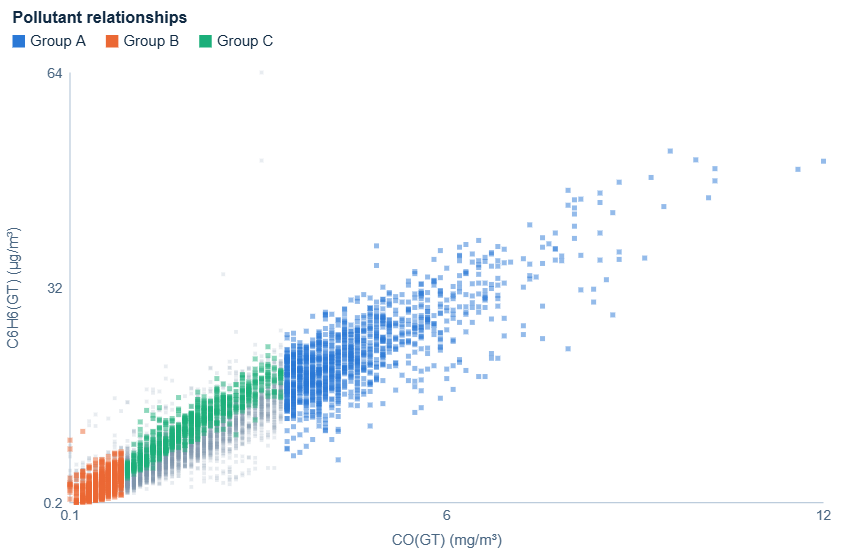
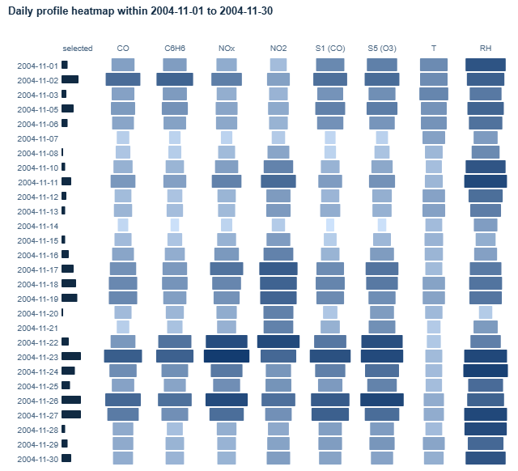

# Task 1: Discovery of Grouping

Draft section for the group report. Figures are in `figures/task1-grouping/`; the tool is `code/task-1/html/index.html`.

## Data used

Attribute Set A: timestamp, CO(GT), C6H6(GT), NOx(GT), NO2(GT), PT08.S1(CO), PT08.S5(O3), T and RH. Values of −200 were treated as missing and never imputed. All views use the same complete-case cohort: the 6,941 hours (74% of 9,357) in which all eight attributes are valid. Hours with any missing attribute are left out, not filled in. Hour of day, weekday, month and season are derived from the timestamp only.

## Visual analytic tool

The tool is a custom web application with four linked views: parallel coordinates, a scatterplot, a daily heatmap and a group-composition panel. Each view was chosen for a specific part of Task 1.

| View | Encoding | Why it reveals groupings |
|---|---|---|
| **Parallel coordinates** (primary view) | One polyline per hour across the eight attributes; colour = season, time of day, day type or saved group | Hours with similar profiles form bundles of near-parallel lines. The axis positions a bundle passes through show directly which attributes define it |
| **Scatterplot** (any two attributes) | Position; colour as above | Shows separation and density for a chosen pair, and whether a relationship differs between groups |
| **Daily heatmap** | Rows = days, columns = attributes; daily median as sequential blue lightness *and* cell width; left bar = selected hours per day | Groups of *days* show up as runs of similar rows (e.g. weekly rhythm, multi-day episodes) |
| **Group-composition panel** | For each hour of day, weekday and month: share of visible hours in that slot that belong to the group; median profile table | Answers "which time periods form this group?" and corrects for unequal numbers of complete hours per slot |

**Design decisions**
- **Axis order:** reference analysers (CO, C6H6, NOx, NO2), then sensors (S1, S5), then environment (T, RH). Strongly related pollutants sit next to each other, so a bundle reads as near-parallel lines, while the environmental axes show contrasts as crossings. Axes can be dragged to reorder them.
- **Axis scale:** each axis spans the 1st–99th percentile of the cohort and labels its raw end values (≥/≤ marks clipped ends). With full min–max scaling, a few extreme hours (e.g. CO 11.9 mg/m³) squashed most lines into the bottom fifth. Domains are fixed over the whole cohort, so axes don't move when filtering and views stay comparable.
- **Overplotting:** 6,941 lines are drawn at 3% opacity, in a fixed pseudo-random order and interleaved in small chunks, so no season or month is systematically painted on top. Clicking a legend category isolates it.
- **Colour:** categorical palettes were checked with a colour-vision-deficiency validator for all colour pairs. Saved groups use three colours that pass every check, which is why the tool caps saved groups at three. Season and time of day use four colours that are in the warning band for colour-blind separation, so the clickable legend provides a second cue. The heatmap uses a single-hue sequential ramp, because daily medians are magnitudes rather than deviations from a midpoint.
- **Interaction:** brushing on one or more parallel-coordinate axes (combined with AND), box selection in the scatterplot and day selection in the heatmap all drive one shared selection. A selection can be saved as a named group with a persistent colour. Saved groups keep their colour across every view and filter, and their median profile is drawn as a thick line in the parallel coordinates.

No clustering algorithm is used anywhere. Every group below was formed by brushing a bundle that was visible in the parallel coordinates.

## Discovery process

1. **Overview by season** (Fig. 6, Fig. 7). Isolating each season in the parallel coordinates showed two clearly different shapes. Winter lines sit at the bottom of T and the top of RH and reach high on NO2 (Fig. 6). Summer lines converge at the top of T and the bottom of RH, and drop to the floor of the NOx axis (Fig. 7). Autumn contained most of the lines running along the top of every pollutant and sensor axis.
2. **Overview by time of day** (exploration figures). Night lines (00–05) lie along the bottom of all pollutant axes. Afternoon lines (12–17) form the tight high-T / low-RH bundle. Evening lines (18–23) spread over the upper half of the pollutant axes.
3. **Brushing the visible bundles.** Each bundle was brushed where it separates from the rest on the axes, saved as a group, and inspected in the composition panel (Figs 1–3).
4. **Checking groups of days** in the heatmap (Fig. 5).

## Groupings found

*Fig. 1. Parallel coordinates coloured by saved group; thick lines are group median profiles.*

*Fig. 3. Composition of each group by hour of day, weekday and month, with medians against all visible hours. The top card is the cold-hours selection (Group D).*

| Group | Brushed on | Hours | Defining attributes (visual evidence) | Time periods it contains |
|---|---|---|---|---|
| **A: traffic peaks** | CO ≥ 3.5 | 1,172 (17%) | The bundle stays high on *every* pollutant and sensor axis together. Medians: CO 4.3, C6H6 22, NOx 531, NO2 161, S1 1,438, S5 1,622 (all-hour medians 1.9, 8.8, 186, 110, 1,085, 1,006). T and RH are near typical | Two daily peaks: 08–09 (36–37% of those hours) and 18–20 (44–51%). Tue–Fri 22–24%, Monday 14%, Saturday 9%, Sunday 4%. Present all year except August 2004 (0%); highest Oct–Nov 2004 (29–31%) |
| **B: clean nights** | CO ≤ 0.9 and NOx ≤ 90 | 855 (12%) | The bundle runs along the floor of all pollutant and sensor axes. Medians: CO 0.6, C6H6 2.8, NOx 46, NO2 51, S5 571 | Early morning 02–06 (peak 64% at 04–05). Sundays 24% vs 8–14% on other days. Mostly Apr–Aug 2004 (16–29%), rare Oct 2004–Mar 2005 (4–7%) |
| **C: hot, dry afternoons** | T ≥ 26 and RH ≤ 35 | 906 (13%) | The environmental axes define it (high T, low RH). Its lines fall towards the bottom of the NOx axis (median 134 vs 186), while CO and NO2 stay near typical | 10:00–20:00 (peak 28–32% at 12–17). All weekdays equally (11–16%). May–Sep 2004, peak July 2004 (53%); absent Oct 2004–Feb 2005 |
| **D: cold, humid hours** (shown as a selection) | T ≤ 10 | 1,431 (21%) | Low T and higher RH (median 57%) come with elevated NOx (254) and NO2 (131) while CO stays below typical (1.6). The dashed median in Fig. 4 peaks at NO2 | All hours, mostly night and morning (25–34% of hours 00–09, apart from the sparse 03:00 slot, vs 9–11% at 12–17). All weekdays equally. Mainly Nov 2004–Mar 2005, peak Feb 2005 (78%) |

*Fig. 2. CO vs C6H6 coloured by group. A and B separate along the shared CO–C6H6 band, while C sits on its upper edge.*

*Fig. 5. Daily heatmap for November 2004, with Group A's brush active; the left bar counts high-CO hours per day.*

**Groupings differ over hours and days**
- **Hours:** the same hour of day belongs to different groups depending on the season. Afternoons are hot, dry Group C hours in summer but never in winter; early mornings are clean Group B hours in spring and summer but rarely in winter (Fig. 3, month panels).
- **Days:** in the heatmap the Sundays 7, 14 and 21 November form visibly lighter rows on every pollutant column with almost no Group A hours, while 22–27 November forms a dark multi-day episode with long Group A bars (Fig. 5). Days therefore group into a weekly rhythm (weekday vs Sunday), with occasional episode weeks on top.

## Limitations and overlaps

- **C6H6 and CO / S2 overlap.** C6H6(GT) is effectively a function of the PT08.S2 sensor and correlates strongly with CO, so groups defined by "high CO and C6H6" reflect one traffic signal, not two independent ones. Fig. 2 also shows that at the same CO, Group C's hot hours sit higher in C6H6. That is consistent with the temperature sensitivity of the sensor behind C6H6, so C6H6 differences between hot and cold periods should not be read as purely chemical.
- **Sensor drift.** The metal-oxide sensors (S1, S5) drift and respond to temperature and humidity, so seasonal differences on the sensor axes are partly instrumental.
- **Brush limits are visual choices.** They mark where bundles separate, not exact boundaries; the relationships are continuous. Groups can overlap: A∩C = 102 hours and B∩C = 97 hours; A and B do not overlap. An overlapping hour takes the colour of the first group listed.
- **Coverage.** The complete-case cohort under-represents months with analyser gaps (e.g. October 2004). The 03:00 bars rest on very few complete hours, because of the daily NOx/NO2 analyser gap.

## Reproducing the figures

Open `code/task-1/html/index.html` in a browser.
1. **Groups:** brush CO from 3.5 to the top of its axis and click *Save selection as group* (Group A). Then brush CO up to 0.9 together with NOx up to 90 and save (Group B). Then brush T from 26 upwards together with RH up to 35 and save (Group C).
2. **Group D:** brush T up to 10 and leave it as the current selection.
3. **Heatmap:** for Fig. 5, set the dates to 1–30 November 2004 with the CO ≥ 3.5 brush active.

Each view's *PNG* button exports the figure with its legend and active filters.
